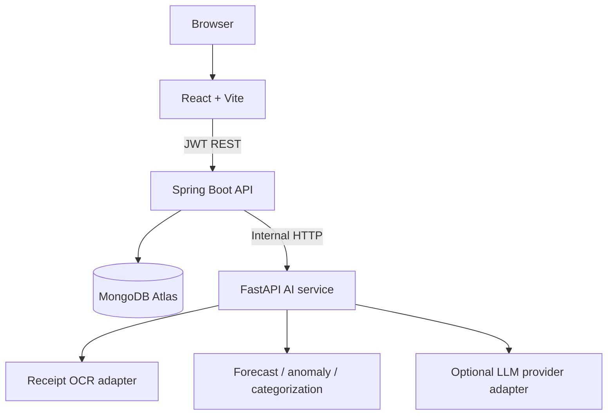

# System architecture

## Trust boundaries
- The browser never connects directly to MongoDB.
- Every finance API requires a bearer JWT; records are queried by authenticated user ID.
- Passwords are stored as BCrypt hashes. The API never returns password hashes.
- Money is stored as integer paise to avoid floating-point currency errors.
- AI output is advisory. OCR candidates must be reviewed by the user before being saved as a transaction.
- The AI service is private to the backend in deployment; do not expose credentials in frontend code.

## Collections
`users`, `transactions`, `budgets`, `financialGoals`, `recurringTransactions`. Future `aiInsights` records should include source transaction IDs and model/version metadata.
